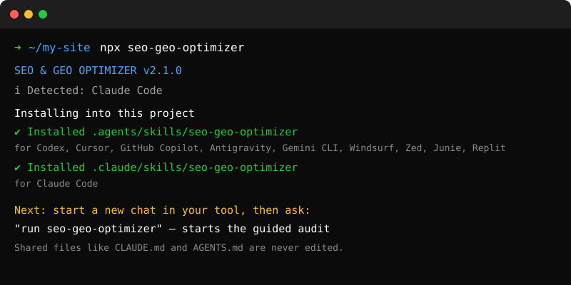

<div align="center">

<h1>seo-geo-optimizer</h1>

<p><strong>An agent skill that runs a structured SEO and GEO audit of your site.</strong><br>
It asks before it assumes, plans before it changes anything, and cites an official source for every recommendation.</p>

[](https://www.npmjs.com/package/seo-geo-optimizer)
[](https://www.npmjs.com/package/seo-geo-optimizer)
[](LICENSE)
[](https://agentskills.io)
[](https://github.com/Aryanpanwar10005/seo-geo-optimizer/stargazers)

</div>

Your AI coding agent (Claude Code, Codex, Cursor, GitHub Copilot, Windsurf, Antigravity and others) gets a step-by-step workflow for technical SEO, structured data, Core Web Vitals, content and AI-search visibility across Google, Bing, AI Overviews, Copilot, ChatGPT and Perplexity. The agent interviews you about the site, studies real competitors, writes an execution plan, and then works through it one tier at a time, stopping for your approval before every change.

<div align="center">
  
</div>

## Quick start

In your project folder:

```bash
npx seo-geo-optimizer
```

The installer copies the skill into `.agents/skills/seo-geo-optimizer/`, which most AI coding tools read, and into the folders of any other tools it detects. Using Claude Code? Add `--claude` if your project has no `.claude/` folder or `CLAUDE.md` yet.

Or use the [skills CLI](https://github.com/vercel-labs/skills):

```bash
npx skills add Aryanpanwar10005/seo-geo-optimizer
```

Then start a new chat in your tool and ask: **`run seo-geo-optimizer`**. In Claude Code it is also the `/seo-geo-optimizer` command; in Codex, `$seo-geo-optimizer`. Ordinary SEO questions get a direct answer; the full workflow only starts when you ask for it.

## What happens when you run it

| Phase | What the agent does |
|---|---|
| 0 | Confirms you want the full workflow and explains the intake |
| 1 | Asks 32 intake questions in five groups: product, audience, competitors and current state, goals and constraints, AI visibility |
| 2 | Analyses 3–5 real search competitors |
| 3 | Assesses keyword and opportunity gaps |
| 4 | Writes an Execution Plan Report and **waits for your written approval** |
| 5–9 | Works through five tiers, one at a time, reporting and asking before moving on: critical foundations, performance and on-page, content and authority, GEO and AI visibility, content and blog SEO |
| 10 | Runs the final verification checklist, pass or fail for every item |
| 11–13 | Sets up monitoring, a maintenance timeline and a list of official references |
| 14 | Hands over a final audit report |

Every individual change follows the same protocol: what changes, why (with an official source), the exact diff, the risk, then your yes, no or modify.

## The 8 iron laws

1. **Read before acting:** the agent reads the skill (and the reference file for each phase) before doing anything.
2. **Ask, never assume:** missing facts about your product come from you, not from guesses.
3. **Collect all data first:** no plan until the intake and competitor analysis are done.
4. **Plan before executing:** no code, markup or content until you approve the plan.
5. **Zero autonomous changes:** every change needs your approval, including small fixes.
6. **Cite every recommendation:** each one links to official documentation.
7. **One phase at a time:** the agent stops and reports after every phase.
8. **Flag temporary fixes:** any workaround is labelled `[TEMPORARY FIX]` with the permanent solution.

## Where it installs

| Tool | Project folder | With `--global` |
|---|---|---|
| Codex, Cursor, GitHub Copilot, Antigravity, Gemini CLI, Windsurf / Devin, Zed, JetBrains Junie, Replit Agent | `.agents/skills/` (always) | `~/.agents/skills/` (Cursor: `~/.cursor/skills/`, Copilot: `~/.copilot/skills/`, Windsurf: `~/.codeium/windsurf/skills/`, Antigravity: `~/.gemini/config/skills/`) |
| Claude Code | `.claude/skills/` (if detected or `--claude`) | `~/.claude/skills/` |
| Cline | `.cline/skills/` (if detected or `--cline`) | `~/.cline/skills/` |
| Kiro | `.kiro/skills/` (if detected or `--kiro`) | `~/.kiro/skills/` |
| Trae | `.trae/skills/` (if detected or `--trae`) | `~/.trae/skills/` |
| Lovable, Bolt | Added in their web apps: run with `--lovable` or `--bolt` for the steps | — |

The installer **never edits shared instruction files** such as `CLAUDE.md`, `AGENTS.md`, `.github/copilot-instructions.md` or `GEMINI.md`. Re-running it updates the skill in place, and it will not overwrite a different skill that happens to use the same folder name.

### Options

| Option | What it does |
|---|---|
| `--claude`, `--cline`, `--kiro`, `--trae` | Also install for that tool (combine freely) |
| `--cursor`, `--copilot`, `--codex`, `--windsurf`, `--antigravity`, `--gemini`, `--junie`, `--zed`, `--replit` | Named targets; in a project they share `.agents/skills/` |
| `--all` | Every project folder in the table |
| `--global` | Install for your user account instead of the current project |
| `--uninstall` | Remove the skill (only this skill) from those folders |
| `--remove-legacy` | Delete files that a 1.x install created for itself |
| `--dry-run` | Show what would happen without writing anything |
| `--force` | Replace a different skill that uses the same folder name |
| `--version`, `--help` | Version and full help |

### Tools without skills support

Paste the single-file version, [`skill/SEO_GEO_SKILL.md`](skill/SEO_GEO_SKILL.md), into your tool's custom instructions or system prompt:

```
https://raw.githubusercontent.com/Aryanpanwar10005/seo-geo-optimizer/main/skill/SEO_GEO_SKILL.md
```

## Upgrading from 1.x

Version 1.x wrote the whole skill into files your tools load on every request, and for some tools it overwrote shared files (`CLAUDE.md`, `.github/copilot-instructions.md`, `.bolt/prompt`, `~/.gemini/GEMINI.md`), keeping a `.backup` copy. Version 2.1 installs a skill folder instead. When you run it, the installer lists any 1.x leftovers:

- Files 1.x created for itself (for example `.cursor/rules/seo-geo-optimizer.mdc`): rerun with `--remove-legacy` to delete them.
- Shared files it overwrote: restore them from the `.backup` file next to them. The installer never touches these.

## What the skill covers

| Part | Topic |
|---|---|
| 1–2 | Iron laws, phases and the approved-change protocol |
| 3 | Intake questionnaire |
| 4 | Competitor analysis framework |
| 5 | Execution Plan Report template and tier task lists |
| 6 | JSON-LD structured data templates |
| 7 | Meta tag rules |
| 8 | Core Web Vitals |
| 9 | Google vs. Bing differences |
| 10 | Verification checklist |
| 11 | Algorithm update monitoring |
| 12 | Execution timeline |
| 13 | Official references index |
| 14 | Content SEO and blog optimization |

In the Agent Skills edition, Parts 1–2 live in `SKILL.md` and each later part is a file in `references/` that the agent reads when its phase starts, so the skill stays light until you use it.

## Repository structure

```
seo-geo-optimizer/
├── skill/
│   └── SEO_GEO_SKILL.md          ← Source of truth (single file, also for tools without skills)
├── skills/
│   └── seo-geo-optimizer/        ← Agent Skills edition, generated by npm run sync:skill
│       ├── SKILL.md
│       └── references/           ← One file per part, loaded on demand
├── bin/install.js                ← The npx installer
├── scripts/
│   ├── sync-skill.js             ← Builds skills/ from skill/
│   └── validate.js               ← npm run validate
├── test/install.test.js          ← Installer tests (temporary projects)
└── examples/                     ← Sample intake answers and llms.txt
```

## Contributing

1. Edit the skill in `skill/SEO_GEO_SKILL.md` only, then run `npm run sync:skill`.
2. Run `npm run validate` and `npm test`.
3. Open a pull request that explains what changed and links the official source for any SEO or GEO claim.

See [CONTRIBUTING.md](CONTRIBUTING.md) for what we accept.

## License

MIT, see [LICENSE](LICENSE).

---

<div align="center">

**[⭐ Star this repo](https://github.com/Aryanpanwar10005/seo-geo-optimizer/stargazers)** if it saves you time. It helps others find it.

Made with ☕ by [Aryan Panwar](https://aryanpanwar.in) · [Why I built it](https://aryanpanwar.in/case-studies/seo-geo-optimizer)

</div>
